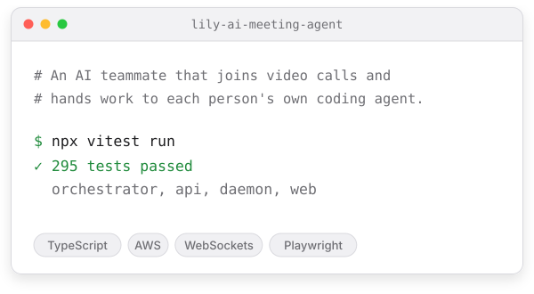
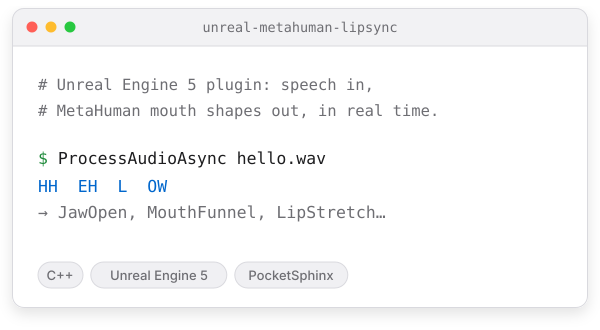
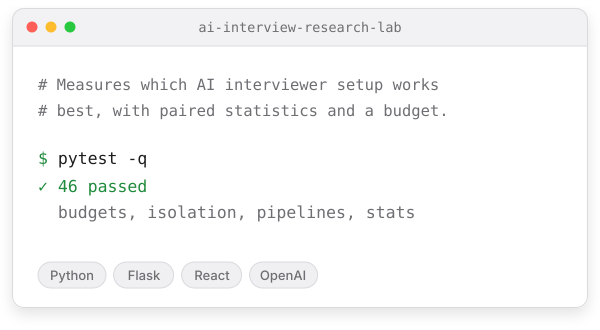
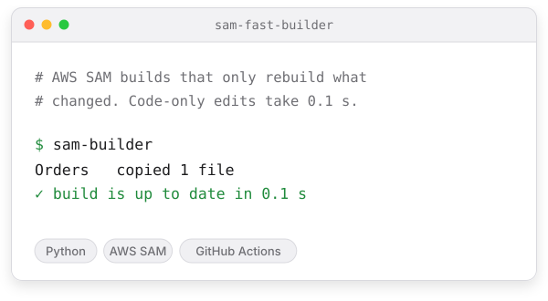

<picture>
  <source media="(prefers-color-scheme: dark)" srcset="assets/hero-dark.svg">
  
</picture>

<a href="https://github.com/eviorthegg/lily-ai-meeting-agent"><picture>
  <source media="(prefers-color-scheme: dark)" srcset="assets/lily-dark.svg">
  
</picture></a>
<a href="https://github.com/eviorthegg/unreal-metahuman-lipsync"><picture>
  <source media="(prefers-color-scheme: dark)" srcset="assets/lipsync-dark.svg">
  
</picture></a>

<a href="https://github.com/eviorthegg/ai-interview-research-lab"><picture>
  <source media="(prefers-color-scheme: dark)" srcset="assets/research-dark.svg">
  
</picture></a>
<a href="https://github.com/eviorthegg/sam-fast-builder"><picture>
  <source media="(prefers-color-scheme: dark)" srcset="assets/sam-dark.svg">
  
</picture></a>

**Stack** · TypeScript, Node.js, React, Python, C++ · AWS (Lambda, SAM, API Gateway), Google Cloud · MongoDB, SQL, Redis · WebSockets, WebRTC, LLM APIs · Unreal Engine 5

**Contact** · [eviortech@gmail.com](mailto:eviortech@gmail.com)
